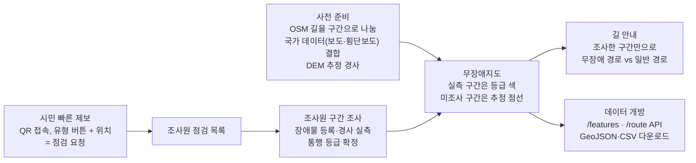

# 동해 무장애지도 기획서

작성: 관 · 최종 수정: 2026-11-11 · 용도: 발표·심사용 배경과 근거
요구사항은 [PRD.md](PRD.md), 기술 구성·데이터 구조·비용은 [TECH_SPEC.md](TECH_SPEC.md)가 기준이다. 이 문서와 다르면 두 문서를 따른다.

## 한눈에 보기

동해시에는 휠체어·유모차가 다닐 수 있는 길인지 판단할 데이터가 사실상 없다. 이 서비스는 조사단이 길을 구간마다 직접 걷고 재서 그 데이터를 만들고, 무장애지도와 길 안내로 보여주며, 누구나 쓸 수 있게 API로 공개한다.

- **문제:** OpenStreetMap 기준 동해시 일대 길 3,639개 중 경사 정보 1건, 연석·단차 정보 0건. 국가 공간정보에도 보도의 경사·단차 데이터는 없다
- **해결:** 조사원(팀·자원봉사자)이 구간을 걸으며 장애물을 등록하고 경사를 실측 → 구간마다 통행 등급(통행 가능·주의·통행 어려움) 확정 → 조사한 길로 무장애 길 안내 → 데이터를 API·파일로 개방
- **주 사용자:** 조사원. 시민은 "여기 봐주세요" 빠른 제보로 참여하고, 휠체어·유모차 사용자는 지도와 길 안내를 쓴다
- **차별점:**
  - 장애물만 모으는 게 아니라 **"이 길은 지나갈 수 있다"**는 정보를 만든다. 무장애지도에 꼭 필요하지만 제보만으로는 생기지 않는 정보다
  - 휴대폰 기울기 센서로 경사를 실측한다
  - 데이터가 OSM 길에 연결돼 있고 `/route` API로 다른 길 안내 앱도 쓸 수 있다
- **성공 지표:** 시연 지역 보행 구간 중 조사를 마친 비율 (상세는 PRD 13절)
- **해커톤 주제:** 지정주제 2(사회적 약자 공공서비스 접근성), 무장애 관광으로 지정주제 1과 연결

## 왜 이 문제인가

길 안내 알고리즘은 이미 있지만, 동해시에는 그 알고리즘에 넣을 보행 데이터가 없다. 2026년 10월 21일 OpenStreetMap을 직접 조회한 결과다(동해시를 감싸는 사각형 범위라 인접 시 경계가 일부 포함될 수 있음).

| 항목 | 개수 | 의미 |
| --- | --- | --- |
| 도로·길 전체 | 3,639 | 비교 기준 |
| 보행로(footway) | 208 | 보행 네트워크 일부만 존재 |
| 차도에 보도 유무 표시 | 51 | 전체의 약 1.4% |
| 계단 | 17 | |
| 경사 정보 | 1 | 사실상 없음 |
| 폭 정보 | 13 | 사실상 없음 |
| 연석·단차 정보 | 0 | 전혀 없음 |
| 휠체어 접근 가능 여부 | 8 | 장소 단위 정보도 거의 없음 |

국가 공간정보도 확인했다(2026-11-11). 국토지리정보원 수치지형도에는 보도 형상이, 전국횡단보도표준데이터에는 횡단보도 턱낮춤 여부가 있다. 이 둘은 서비스에 활용한다. 그러나 **보도의 경사와 단차를 담은 데이터는 어디에도 없다.** 이 빈칸은 현장에서 재는 것 말고는 채울 방법이 없다.

이 데이터가 필요한 사람은 늘고 있다.

- 65세 이상 비율이 25%를 넘어 초고령사회에 들어섰다 ([쿠키뉴스](https://www.kukinews.com/article/view/kuk202507170227))
- 시 관광종합개발계획이 무장애 관광을 추진 과제로 제시했다 ([쿠키뉴스](https://www.kukinews.com/article/view/kuk202603030148))
- 시가 인공지능 기본조례를 만들고 인공지능위원회를 출범시켜 AI 기반 행정에 관심이 높다 ([베리타스알파](https://www.veritas-a.com/news/articleView.html?idxno=628081))

## 서비스 구조

조사단이 확정하고, 시민은 신호를 준다. 조사하지 않은 곳은 지형 데이터로 추정해 보여주되, 추정임을 분명히 표시한다.

**기본 단위는 구간 조사다.** 조사원이 교차점 사이의 길 구간을 걸으며 장애물과 경사를 기록하고, 구간마다 통행 등급을 확정한다. 장애물 제보만 모으면 문제없는 길을 알 수 없기 때문이다.

**길 안내는 조사한 구간 안에서만 한다.** 데이터가 없는 곳에서 경로를 단정하면 휠체어 사용자를 계단이나 턱 앞으로 보낼 수 있다. 그래서 조사를 마친 구간만으로 경로를 찾고, 일반 최단 경로와 나란히 보여준다.

## 핵심 기능

| 화면 | 사용자 | 핵심 기능 |
| --- | --- | --- |
| 조사 | 조사원 | 조사 지도(미조사·등급별 구간 + 시민 제보) → 구간 선택 → 장애물 등록·경사 실측 → 통행 등급 확정 |
| 무장애지도·길 안내 | 휠체어·유모차 사용자, 고령자, 관광객 | 구간 등급 색, 실측·추정 구분, 출발·도착을 찍으면 무장애 경로와 일반 경로 비교 |
| 빠른 제보 | 시민 | QR로 설치 없이 접속 → 유형 버튼(턱·계단·급경사·좁은 길·파손) + 위치 → 전송 |
| 데이터 | 개발자·분석가 | Swagger API 문서, GeoJSON·CSV 다운로드 |

요구사항 전체와 우선순위는 PRD 5절에 있다.

**AI가 맡는 일**
- 시민이 올린 사진·글에서 장애물 유형을 분류한다(P1). 유형 같은 범주만 뽑고 높이·경사 같은 **수치는 뽑지 않는다.** 사진으로는 잴 수 없기 때문이다
- 조사 결과 보고서 자동 작성(로드맵)

**수치는 현장 실측으로만 얻는다.** 경사는 휴대폰 기울기 센서로, 턱 높이와 폭은 줄자로 잰다. GPS 고도는 쓰지 않는다. 휴대폰 GPS의 높이 오차는 수 미터인데, 8.3% 경사로는 10m를 가는 동안 약 0.83m만 오르기 때문이다.

## 데이터 원칙

수집한 데이터를 남이 쓰기 쉽게 만드는 것이 이 서비스의 핵심 가치다. 테이블 구조와 값 정의는 TECH_SPEC 4절에 있다.

- **표준을 따른다:** OpenStreetMap 태그(`kerb`, `incline`, `width`, `surface`, `wheelchair`)를 그대로 쓰고, 보행 접근성 스키마는 OpenSidewalks를 참고한다
- **OSM 길에 연결한다:** 모든 구간과 장애물이 OSM 길 ID를 갖는다. 그래야 라우팅 엔진에 투입할 수 있다
- **출처를 남긴다:** 측정값마다 `dem`(지형 추정), `phone_sensor`(폰 측정), `field_verified`(현장 확인) 중 하나를 붙인다. 쓰는 사람이 추정과 실측을 구분할 수 있다
- **원본과 AI 결과를 나눈다:** AI 결과는 추론이지 사실이 아니다. 시민 제보 원본과 AI 추출 결과를 따로 저장한다
- **이력을 지우지 않는다:** 장애물은 고쳐지기도 한다. 상태 변화를 덮어쓰지 않고 이력으로 남긴다
- **개인정보:** 공개 데이터에는 제보자 정보, 제보 원문, 시민 사진을 넣지 않는다. 사진은 업로드 전에 위치 정보(EXIF)를 지운다
- **라이선스:** 제보 화면에서 공개 라이선스 동의를 받는다. OSM 길 형상을 쓰는 구간 레이어는 ODbL이 붙으므로 장애물 레이어와 나눠 배포한다

## 본선 시연

동해 청소년센터와 동해시종합버스터미널 주변에서 시연한다. 본선 1일차에 현장을 조사하고, 2일차에 그 데이터로 시연한다.

> "어제 우리가 직접 걷고 잰 길로 안내합니다."

핵심 장면은 **터미널 → 청소년센터 길 안내**다. 버스로 동해에 온 휠체어 사용자가 해커톤 장소까지 가는 길이다. 일반 최단 경로는 계단·턱을 지나고, 무장애 경로는 그걸 피해 조금 돌아간다는 걸 나란히 보여준다. 전체 시나리오는 PRD 10절에 있다.

**발표 자료로 보여줄 것**
- 동해 전역으로 넓히는 계획과 조사 속도 기준의 커버리지 예측(현장 테스트 T4 결과 기반)
- 공무원·자원봉사 조사단 운영 제안
- `/route` API: 다른 길 안내 앱도 무장애 경로를 받아갈 수 있다
- 공공데이터포털 등록 방안
- 로드맵: 보도를 별도 선으로 매핑, 조사 보고서 자동 작성, 재조사 주기

## 30일 운영

대회 후 30일 동안 서비스를 켜둔다.

- **누가 조사하나:** 시가 정식으로 채택하기 전까지 공무원 참여는 보장되지 않는다. 30일 동안은 팀원과 자원봉사자가 직접 조사한다
- **비용:** 필수 지출은 0원이다. 무료 플랜 한도, 일시정지·백업 대비, 유료 전환 판단은 TECH_SPEC 10절에 있다
- **30일 뒤 넘길 것:** 시연 지역 구간 조사 완료 비율, 등급별 구간 수, 장애물 목록, 전체 데이터 파일과 데이터 사전

## 위험 요소와 대비

| 위험 | 대비 |
| --- | --- |
| 시연 경로에서 무장애 경로가 안 나오거나 일반 경로와 차이가 없음 | 본선 전 동해 방문으로 시연 경로를 미리 조사하고, 일반 경로에 장애물이 있는 구간을 찾아둔다 |
| HTTPS가 아니면 위치·기울기 센서가 동작하지 않음 | Vercel 배포로 HTTPS 확보 |
| QR을 카카오톡·네이버 앱으로 열면 센서·위치가 막힘 | 앱 안 브라우저를 감지해 Safari·Chrome으로 열도록 안내 |
| 아이폰·안드로이드 동작 차이 | 아이폰 + 안드로이드 1대 이상으로 사전 테스트. 아이폰의 Chrome은 Safari와 같은 엔진이라 안드로이드를 대신하지 못한다 |
| 무료 플랜에는 백업이 없어 1일차 조사 데이터 유실 | 본선 기간 몇 시간마다 데이터 내보내기 |
| 장난·부정확한 제보 | 시민 제보는 점검 요청일 뿐, 공개 데이터는 조사원이 확정. 숨김 기능 |
| AI가 사진에서 수치를 지어냄 | AI는 범주만 추출, 수치는 실측에서만 |
| 시연 때 지도가 비어 보임 | 터미널 주변을 사전 조사해 둔다 |

## 아직 확인되지 않은 사항

세부 확인 항목은 PRD 15절과 TECH_SPEC 9절에 있다. 기획 차원에서 남은 것은 다음과 같다.

- [ ] 서비스 이름 (미정)
- [ ] 30일 운영비(Supabase Pro) 지원 여부 — 주최 측 문의
- [ ] 동해시 담당 부서 접촉 시점, 시가 보도·교통약자 시설을 현재 어떻게 점검하는지
- [ ] 자원봉사자 모집 경로 (동해시 자원봉사센터, 대학 봉사 동아리 등)
- [ ] 한국관광공사 무장애 여행 정보에 동해시 관광지가 얼마나 수록돼 있는지
- [ ] 경사·턱 기준의 법령 조항 확인 (장애인등편의법 시행규칙)
- [ ] OSM 수치를 정확한 동해시 행정경계로 다시 조회 (현재는 사각형 범위 근사값)

## 일정

참가 신청 마감은 2026년 10월 25일(10월 22일에서 연장), 본선은 2026년 11월 20\~21일 동해 청소년센터에서 무박 2일로 열린다 ([대학저널](https://www.dhnews.co.kr/news/view/1065598155008015)). 계획서 심사를 통과해 본선에 진출했다. 사전 코드 작성은 허용된다.

본선까지의 날짜별 계획은 작업 목록(팀 내부 문서)(개발)와 [TEST_PLAN.md](TEST_PLAN.md)(테스트·디자인)에 있다.

## 출처

- [쿠키뉴스: 동해시 농어촌 의료지원 제외(고령화율)](https://www.kukinews.com/article/view/kuk202507170227)
- [쿠키뉴스: 동해시 관광종합개발계획](https://www.kukinews.com/article/view/kuk202603030148)
- [베리타스알파: 동해시 인공지능위원회 발족](https://www.veritas-a.com/news/articleView.html?idxno=628081)
- [대학저널: G-Lab@동해 해커톤 개최](https://www.dhnews.co.kr/news/view/1065598155008015)
- [공공데이터포털: 국토지리정보원 DEM](https://www.data.go.kr/data/15059920/fileData.do)
- [국가공간정보포털: 인도(보도)](http://data.nsdi.go.kr/dataset/20180927ds0063)
- [공공데이터포털: 전국횡단보도표준데이터](https://www.data.go.kr/catalog/15028201/fileData.json)
- OpenStreetMap Overpass API 직접 조회 (2026-10-21)
