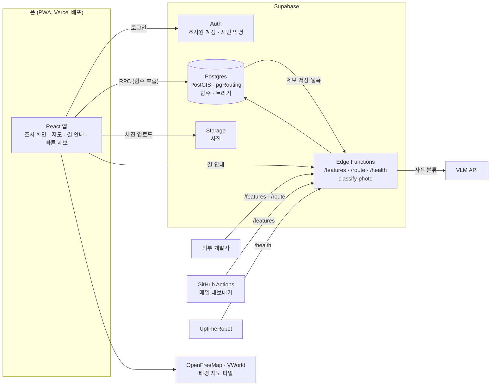

# 동해 무장애지도 기술 명세

작성: 관 · 최종 수정: 2026-11-11 · 독자: 개발자, AI 코딩 에이전트
관련 문서: [PRD.md](PRD.md) (무엇을 왜 만드는지, 요구사항 ID `R-xxx`). 이 문서는 "어떻게"를 다룬다.

> **2026-11-20 이후 바뀐 결정은 [HANDOFF.md](../HANDOFF.md) 3절(🆕)에 있고, 충돌하면 HANDOFF가 맞다.** 특히 지도(카카오), 길 안내(기기 안 계산·법 기준), 현장 조사(메인 지도), 공개 API(Vercel 함수)가 이 문서와 다르다.

## 1. 기술 선택 요약

| 영역 | 선택 | 고른 이유 | 막히면 |
| --- | --- | --- | --- |
| 언어 | TypeScript | 프론트와 서버 함수가 같은 언어, 타입 공유 | — |
| 프론트엔드 | React + Vite, PWA | AI 코딩 에이전트가 가장 정확하게 다루는 스택, 생태계 최대 | — |
| 서버 데이터 조회 | TanStack Query | 조회·캐시·재요청 처리 | — |
| UI | Tailwind CSS + shadcn/ui | Radix 기반이라 접근성 기본 확보, 시안대로 고치기 쉬움 | — |
| 지도 | MapLibre GL JS | 구간 등급 색·실측/추정 선 모양·경로 비교를 스타일 규칙으로 처리, 모바일에서 부드러움 | Leaflet |
| 배경 지도 | OpenFreeMap (회색조) | 무료, 키 없음, 색 구간이 잘 보임 | — |
| 항공사진 | VWorld | 조사원이 보도·턱 위치를 맞출 때 사용. 조사 화면에서 켜고 끔 | — |
| 백엔드 | Supabase (Free) | Postgres + PostGIS + pgRouting, 인증, 사진 저장, 서버 함수 일체 | — |
| 서버 로직 | Postgres 함수·트리거 | 데이터 규칙을 DB 안에 두어 앱과 공개 API가 같은 결과를 냄 | — |
| 외부 호출 | ~~Supabase Edge Functions~~ → Vercel 함수 `app/api/` (2026-11-20, Supabase CLI 없음) | AI API 키 보관, 공개 API 응답 형식 고정 | — |
| 길 안내 | ~~pgRouting~~ → 브라우저 계산 (`slopeRoute.ts`, 법 기준, 2026-11-20) | 위치를 서버로 보내지 않음. `/route` API는 공개하지 않음 | — |
| 공개 API 문서 | OpenAPI + Swagger UI | 업계 표준 | — |
| 데이터 준비 | Python: OSMnx + rasterio | 교차점 기준 구간과 노드 ID를 바로 생성, DEM 경사 계산까지 스크립트 하나 | QGIS로 육안 확인 |
| 국가 데이터 | 수치지형도 인도(보도), 전국횡단보도표준데이터 | OSM에 없는 보도 유무와 횡단보도 턱낮춤 정보 | — |
| 기울기 측정 | DeviceMotion 중력 가속도 (기본) | 원시값으로 평균·안정 판정을 직접 제어 | DeviceOrientation 기울기 각 (보조) |
| 사진 처리 | exifr + browser-image-compression | 위치를 먼저 읽고, 줄이면서 EXIF 제거 | Canvas 직접 처리 |
| VLM (P1) | Claude Haiku 5.5 vs Gemini Flash 비교 후 결정 | 5개 유형 분류라 경량 모델로 충분할 가능성이 큼 | Claude Sonnet 5.5 |
| 배포 | Vercel (Hobby) | HTTPS 자동, 브랜치별 미리보기 주소로 팀원 실기기 테스트 | Cloudflare Pages |
| 예약 작업 | GitHub Actions | 매일 내보내기 파일을 저장소에 쌓아 백업 겸용 | — |
| 감시 | UptimeRobot + Sentry | 다운 알림·일시정지 방지 + 실기기 오류 수집 | — |
| 테스트 | Vitest + 실기기 + 크롬 센서 에뮬레이션 | 순수 로직만 자동화, 나머지는 실기기 | BrowserStack (안드로이드 미확보 시) |
| 디자인 도구 | 미정 | 팀 논의 후 결정 | — |

## 2. 아키텍처



**원칙**
- **데이터 규칙은 DB 안에 둔다.** 등급 제안, 장애물 연결, 상태 전이, 경로 계산은 Postgres 함수다. 앱과 공개 API가 같은 함수를 거치므로 결과가 항상 같다.
- **Supabase가 테이블마다 자동으로 만드는 API는 공개용으로 쓰지 않는다.** 앱 내부에서만 RLS를 걸어 쓰고, 외부에는 고정된 `/features`·`/route`만 공개한다. 테이블 구조를 바꿔도 외부 개발자 코드가 깨지지 않고, 비공개 필드가 새지 않는다.
- **API 키는 Edge Functions에만 둔다.** 브라우저 코드에 넣지 않는다.

## 3. 데이터 준비 파이프라인

본선 전에 한 번 돌리고, 지역을 넓힐 때 다시 돌린다. `scripts/prep/` 아래 Python 스크립트 하나로 만든다.

1. **OSM 보행 네트워크:** OSMnx로 시연 지역(청소년센터, 종합버스터미널 주변)의 보행 네트워크를 받는다. 교차점이 노드, 교차점 사이 길이 구간이 된다
2. **구간 분할:** 100m를 넘는 구간은 다시 나눈다 (PRD 6절)
3. **DEM 경사:** rasterio로 구간 양 끝(긴 구간은 일정 간격)의 높이를 읽어 `높이 차 ÷ 거리`로 경사를 계산한다. **선행 조건:** DEM 셀 크기 확인 (PRD R-402)
4. **국가 데이터 결합:**
   - 수치지형도 인도(보도) SHP → 구간마다 `has_sidewalk` 표시. 좌표계를 WGS84로 변환해야 한다(원본 좌표계 EPSG 코드 확인)
   - 전국횡단보도표준데이터 → 가까운 교차점 노드에 횡단보도·턱낮춤 여부를 붙인다
5. **적재:** `nodes`, `segments` 테이블에 넣는다

결과는 QGIS로 열어 눈으로 확인한다. 구간이 끊긴 곳, 엉뚱한 곳에 붙은 횡단보도가 없는지 본다.

## 4. 데이터 모델

좌표는 WGS84(EPSG:4326). 거리 계산은 `geography` 형으로 한다.

| 테이블 | 주요 컬럼 | 공개 |
| --- | --- | --- |
| `nodes` | `id`(OSM 노드 ID), `geom`(점), `crossing`(횡단보도 여부), `crossing_kerb`(`lowered`·`raised`·없음), `crossing_source` | 공개 |
| `segments` | `id`, `osm_way_id`, `source`·`target`(양 끝 노드 ID), `geom`(선), `length_m`, `has_sidewalk`, `dem_incline_pct`, `grade`, `grade_source`(`dem`·`survey`), `surveyed_at` | 공개 |
| `segment_surveys` | `segment_id`, `grade`, `suggested_grade`, `override_reason`, `surveyor_id`, `surveyed_at` | 공개(조사자 제외) |
| `obstacles` | `id`, `geom`(점), `type`(`kerb`·`stairs`·`steep`·`narrow`·`damaged`), `tags`(범주형 OSM 태그, jsonb), `segment_id`, `status`, `photo_path` | 공개(사진 제외) |
| `measurements` | `target_type`(`segment`·`obstacle`), `target_id`, `key`(`incline`·`cross_slope`·`kerb:height`·`width`), `value`, `unit`, `source`(`dem`·`phone_sensor`·`field_verified`), `heading_deg`, `measured_by`, `measured_at` | 공개(측정자 제외) |
| `reports` | `id`, `user_id`(익명), `geom`, `loc_source`, `accuracy_m`, `pin_adjusted`, `user_type`, `text`, `photo_path`, `license_agreed`, `status`, `created_at` | 비공개 |
| `extractions` | `report_id`, `model`, `prompt_version`, `output`(jsonb), `confidence`, `error` | 비공개 |
| `obstacle_reports` | `obstacle_id`, `report_id` | 비공개 |
| `status_events` | `entity_type`, `entity_id`, `from_status`, `to_status`, `actor_id`, `at`, `note` | 공개(처리자 제외) |

**값 정의**
- 구간 등급 `grade`: `unsurveyed` · `passable` · `caution` · `difficult`
- 장애물 상태 `status`: `reported` · `confirmed` · `verified` · `resolved` · `hidden`. 조사원이 등록한 장애물은 바로 `verified`
- 시민 제보 상태 `status`: `pending` · `confirmed`(장애물로 연결) · `not_found` · `hidden`
- 수치는 `measurements`에만 있다. AI 추출 결과(`extractions`)에는 범주형 값만 들어간다

## 5. DB 함수와 권한

| 함수 | 하는 일 | 호출 | 관련 요구사항 |
| --- | --- | --- | --- |
| `suggest_grade(segment_id)` | 측정값·장애물로 등급 제안 (PRD 6절 기준) | 조사 화면 | R-106 |
| `complete_survey(segment_id, grade, reason)` | 조사 기록 저장, 구간 등급·조사일 갱신, 이력 기록 | 조사원 | R-106 |
| `register_obstacle(...)` | 장애물을 `verified`로 등록, 가까운 구간 연결, 측정값 저장 | 조사원 | R-104 |
| `resolve_report(report_id, result)` | 시민 제보를 장애물로 연결하거나 없음·숨김 처리 | 조사원 | R-108 |
| 트리거 `on_report_insert` | 반경 10m 안 같은 유형 제보 묶기, 사진이 있으면 분류 웹훅 호출 | 자동 | R-206, R-207 |
| `route(from, to, include_caution)` | 무장애 경로와 일반 최단 경로를 함께 계산 | `/route` | R-301, R-302 |
| `features(bbox, layer, filters, limit)` | 공개 GeoJSON 생성, 숨김·비공개 필드 제외 | `/features` | R-501 |

**길 안내 (`route`)**
- 찍은 지점에서 가장 가까운 노드를 찾고 `pgr_dijkstra`로 계산한다. 보행이므로 방향 없는 그래프(`directed = false`)로 계산한다
- 무장애 경로는 `grade`가 `passable`(옵션에 따라 `caution`까지)인 구간만, 비용은 `length_m`
- 일반 경로는 모든 구간으로 계산하고, 그 경로가 지나는 장애물·`difficult` 구간을 함께 돌려준다
- 시연 전에 Supabase 대시보드에서 pgrouting 확장이 켜지는지 먼저 확인한다. 막히면 같은 규칙을 브라우저(ngraph.path)로 옮긴다

**권한 (RLS)**
- 시민(익명): 자기 제보 쓰기·읽기만
- 조사원: Auth의 `app_metadata.role = 'surveyor'`. 조사·장애물·제보 처리 함수는 함수 안에서 역할을 확인한다
- 공개 데이터는 공개 API(Vercel 함수 `/api/features`)와 DB 공개 함수 `features()`·`surveyed_segments()`로만 나간다

## 6. 공개 API

~~Edge Functions로 만든다~~ → Vercel 함수(`app/api/features.ts`, `app/api/health.ts` → `app/server/publicApi.ts`, 2026-11-20). 명세는 `docs/openapi.yaml`, 화면은 Swagger UI 정적 페이지(Vercel의 `/docs/api`, 대기).

| 엔드포인트 | 설명 |
| --- | --- |
| `GET /api/features` | `bbox`, `layer`(`segments`·`obstacles`), `grade`, `status`, `since`, `limit`(최대 1,000) → GeoJSON FeatureCollection |
| ~~`GET /route`~~ | 공개하지 않음 (2026-11-20: 길 안내는 앱 안에서 법 기준으로 계산) |
| `GET /api/health` | DB 공개 함수 가장 작은 조회 1건 → `{"status": "ok", "ms", "time"}`. UptimeRobot 전용 |
| `classify-photo` | 내부용. 제보 웹훅이 호출해 VLM 결과를 `extractions`에 저장 (P1) |

공개 응답에는 시민 제보 원문, 사진, 제보자·조사자·측정자 정보, `hidden` 데이터가 들어가지 않는다.

## 7. 현장 기능 구현

**기울기 측정 (R-105)**
- 기본: `devicemotion`의 `accelerationIncludingGravity`(x, y, z)를 약 1.5초 동안 모아 평균을 낸다. 표준편차가 기준 이하일 때만 "안정"으로 보고 기록한다
- 폰을 바닥에 눕혔을 때 긴 축 방향 각도 = `atan2(y, z)`, 짧은 축 방향 = `atan2(x, z)`. 경사(%) = `tan(각도) × 100`
- 180도 돌려 두 번 잰다. 센서 오차는 그대로이고 경사 부호만 뒤집히므로 `실제 경사 = (첫 측정 − 두 번째 측정) ÷ 2`로 오차가 상쇄된다
- 방위: 아이폰은 `webkitCompassHeading`, 안드로이드는 `deviceorientationabsolute`의 `alpha`
- 보조: 중력값이 비어 있으면 `deviceorientation`의 `beta`·`gamma`로 대체
- 아이폰은 버튼 클릭 처리 안에서 `DeviceMotionEvent.requestPermission()`과 `DeviceOrientationEvent.requestPermission()`을 호출해야 한다. 아니면 조용히 거부된다
- 측정 중에는 Screen Wake Lock으로 화면 꺼짐을 막는다(지원하는 브라우저에서)

**앱 안 브라우저 감지**
- 카카오톡·네이버·인스타그램 앱 안의 브라우저는 센서·위치를 막는 경우가 있다. 사용자 에이전트 문자열로 감지해 "Safari 또는 Chrome으로 열기" 안내를 띄운다

**위치 (R-202)**
- 화면에 들어오는 즉시 `watchPosition`(높은 정확도)으로 위치를 받기 시작한다. 오차가 30m를 넘으면 핀을 직접 맞추도록 안내한다

**사진 (R-205)**
- `exifr`로 GPS를 먼저 읽고, `browser-image-compression`으로 긴 변 1600px·1MB 이하로 줄이며 EXIF를 지운다
- 서버에 올라간 파일을 내려받아 GPS 정보가 실제로 없는지 T1에서 확인한다

## 8. 운영

| 항목 | 방법 |
| --- | --- |
| 배포 | Vercel. 브랜치마다 생기는 미리보기 주소를 QR로 만들어 팀원이 실기기 테스트 |
| DB 변경 | Supabase CLI 마이그레이션 파일(`supabase/migrations/`)로만 바꾼다. 바꾸기 전에 `supabase db dump`로 통째 저장 |
| 매일 내보내기 | GitHub Actions가 `/features`로 전체 데이터를 받아 GeoJSON·CSV로 `data/exports/`에 커밋. 본선 기간에는 수동 실행으로 몇 시간마다 |
| 활동 유지·다운 알림 | UptimeRobot이 5분마다 `/health` 호출 |
| 오류 수집 | Sentry. 기기, 브라우저, 앱 안 브라우저 여부, 센서 권한 상태를 함께 기록. "권한을 허용했는데도 실패"하는 경우를 잡는 것이 목적 |
| 비밀값 | Supabase·VLM 키는 Vercel과 Supabase의 환경 변수로만 관리. 저장소에 올리지 않는다 |

**폴더 구조 (안)**

```
app/                  React 앱
supabase/migrations/  DB 구조·함수·트리거
supabase/functions/   Edge Functions (쓰지 않음, 2026-11-20). 공개 API는 app/api/ (Vercel 함수)
scripts/prep/         OSM·DEM·국가 데이터 준비 (Python)
data/exports/         매일 내보낸 데이터
docs/                 PRD, TECH_SPEC, TASKS, openapi.yaml
```

## 9. 확인이 필요한 것

- [ ] Supabase에서 pgrouting 확장 활성화
- [ ] DEM 셀 크기 → R-402 유지 여부
- [ ] 수치지형도 인도 SHP의 형상(선·면)과 원본 좌표계, 이용 조건(공공누리 유형)
- [ ] 전국횡단보도표준데이터에 동해시 데이터가 있는지
- [ ] 아이폰 Safari의 Screen Wake Lock 지원 여부
- [ ] VLM 비교: Haiku 5.5 vs Gemini Flash, 기준용 Sonnet 5.5 (샘플 사진 20장)

## 10. 비용

수치는 2026-11-11에 각 서비스 공식 페이지 기준으로 확인했다. 요금제는 바뀔 수 있으니 결제 전에 다시 확인한다.

**결론: 필수 지출은 0원이다.** 모든 서비스를 무료 플랜으로 쓰고, 선택 지출은 Supabase Pro 1개월($25)과 테스트 장비 정도다.

### 무료로 쓰는 것

| 서비스 | 용도 | 조건 |
| --- | --- | --- |
| Supabase Free | DB, 인증, 사진 저장, 서버 함수 | 아래 한도표 참고 |
| Vercel Hobby | 프론트 배포 | 개인·비상업 용도만 허용. 해커톤 공익 프로젝트는 해당. 한도를 넘으면 과금이 아니라 기능이 일정 기간 멈춤 |
| OpenFreeMap | 배경 지도 | 키 없음 |
| VWorld | 항공사진 | 키 발급·도메인 등록 필요 |
| UptimeRobot | 다운 알림, 일시정지 방지 | |
| Sentry | 실기기 오류 수집 | |
| GitHub Actions | 매일 데이터 내보내기 | |

### Supabase 무료 한도와 예상 사용량

본선 2일 + 운영 30일 기준. 가정: 조사원 5\~10명, 제보 수백 건, 사진 수백 장, 지도 열람 약 1,000회, 길 안내 약 2,000회.

| 항목 | 무료 한도 | 예상 | 판단 |
| --- | --- | --- | --- |
| DB 용량 | 500MB | 50MB 미만 | 충분 |
| 파일 저장소 | 1GB | 0.1\~0.3GB (사진 1장 약 300KB) | 충분 |
| **데이터 전송량** | **월 5GB** | **약 1.5\~3GB** | **주의** |
| 월 사용자(MAU) | 50,000명 | 수백 명 | 충분 |
| Edge Function 호출 | 월 50만 건 | 1만 건 안팎 | 충분 |
| 일시정지 | 1주 비활성 시 정지 | UptimeRobot 조회로 방지 | 해결 |
| **백업** | **없음** | | **대비 필요** |
| 로그 보관 | 1일 | 프론트 오류는 Sentry로 보완 | 감수 |

전송량 예상 내역: 지도 열 때 데이터 약 0.5GB, 사진 보기 약 0.6GB, 길 안내 약 0.1GB, 매일 내보내기 약 0.1GB, 개발 중 반복 새로고침 0.5\~1.5GB.

### 돈이 나갈 수 있는 곳

| 항목 | 비용 | 언제 |
| --- | --- | --- |
| Supabase Pro | 월 $25 고정. 지출 상한이 기본으로 켜져 있어 끄지 않으면 초과 과금 없음. 백업(매일, 7일 보관), 일시정지 없음, 전송량 250GB | 30일 운영 때 백업이 필요하면 (주최 측 운영비 지원 시 권장) |
| AI 사진 분류 (Claude Haiku 5.5 기준) | 1장당 약 $0.00025, 1,000장이어도 약 $0.25 | 시민 사진 제보(P1)를 켜면. 사용한 만큼 과금 |
| AI 모델 비교 테스트 | $0.1 안팎 | 본선 전 1회 |
| 디지털 수평계 | 1\~3만 원 | T2 기준값용. 줄자로 높이·거리를 재서 대체 가능 |
| 테스트용 안드로이드 | 중고 몇만 원 | 빌릴 수 없을 때만 |
| 도메인 | 연 1\~2만 원 | 선택. 없으면 Vercel 기본 주소 사용 |
| Vercel Pro | 사용자당 월 $20 | 동해시가 채택하거나 상업 용도가 될 때만 |

AI 비용은 사진 1장을 입력 약 1,500\~2,000 토큰, 출력 약 100 토큰으로 잡아 계산했다.

### 반드시 지킬 것

1. **UptimeRobot은 `/health`만 부른다.** 전체 데이터를 돌려주는 `/features`를 5분마다 부르면 그것만으로 월 4GB가 넘어 전송량 한도를 거의 다 쓴다.
2. **AI API 콘솔에서 월 지출 한도를 건다.** QR로 누구나 접속하므로 남용에 대비한다.
3. **본선 기간에는 몇 시간마다 데이터를 내보낸다.** 무료 플랜은 백업이 없어서, 1일차 조사 데이터가 실수 한 번으로 사라질 수 있다. DB 구조를 바꾸기 전에는 `supabase db dump`로 통째로 저장한다.
4. **Supabase 사용량 화면에서 전송량을 주 1회 확인한다.** 빠듯해지면 고정 데이터인 구간 형상을 Vercel 정적 파일로 옮기고, Supabase에서는 바뀌는 값(등급·장애물)만 받는다.

### 판단 시점

- [ ] 본선 직후: 주최 측 운영비 지원 여부에 따라 30일 운영 동안 Supabase Pro로 올릴지 결정
- [ ] 30일 운영 종료 시: 동해시 이관 여부에 따라 Vercel·Supabase 플랜 재검토
